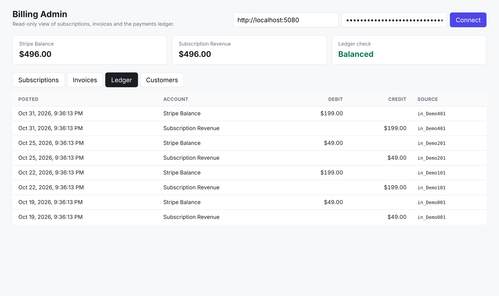
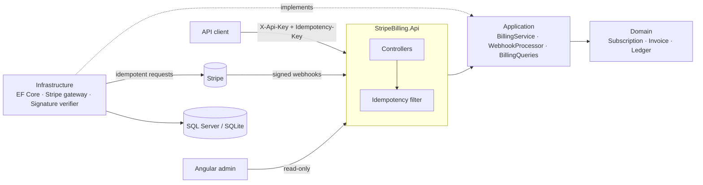
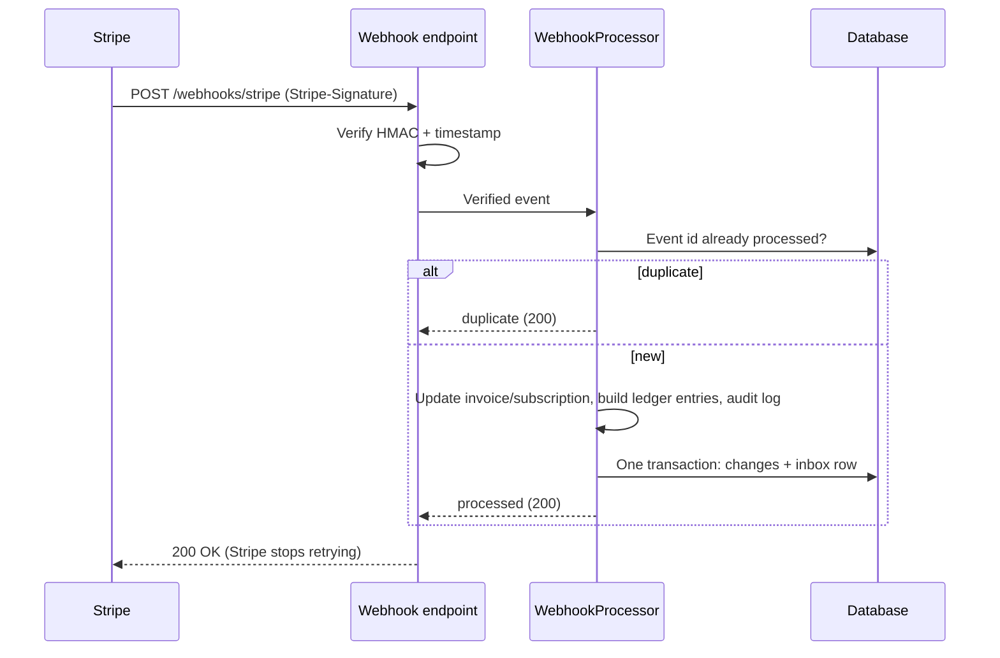

# Stripe Billing for .NET

[](https://github.com/bharatvamsi34/stripe-billing-dotnet/actions/workflows/ci.yml)

A production-style subscription billing service built on **.NET 8**, **Stripe** and **Clean Architecture**, with a small **Angular 17** admin page.

It shows how to handle the parts of payments that usually go wrong: duplicate webhooks, retried API calls, events that arrive out of order, and keeping a ledger that always balances.



## What it does

- Create customers and subscriptions in Stripe, and register plans mapped to Stripe Prices
- Receive Stripe webhooks and keep subscriptions and invoices in sync
- Post every settled payment to an **append-only, double-entry ledger**
- Record an **audit log** entry for every state change
- Expose a read-only admin view of subscriptions, invoices, the ledger and customers

## Payment-safety guarantees

| Problem | How it is handled |
| --- | --- |
| Forged or replayed webhooks | The `Stripe-Signature` HMAC is checked against the raw body before any JSON is trusted, with a 5-minute replay window. |
| Stripe redelivers the same event (at-least-once delivery) | The event id is stored in an **inbox table in the same transaction** as its effects, so each event is applied exactly once, including concurrent duplicates. |
| A client retries `POST /api/customers` after a timeout | `Idempotency-Key` header: the first response is stored and replayed. The key is passed on to Stripe, so a retry never creates a second Stripe object. Reusing a key with a different body returns `422`. |
| Webhooks arrive out of order | Each subscription stores the timestamp of the last applied change; older events are ignored. Canceled subscriptions are terminal. |
| Double posting to the ledger | A unique index per invoice and account blocks it at the database level, as a second line of defence. |
| Someone edits or deletes ledger history | `SaveChanges` rejects any update or delete of a ledger entry. Corrections are new, reversing entries. |
| A late failure notice for a paid invoice | Ignored: a paid invoice is never downgraded. |
| Floating-point rounding | All amounts are `long` values in minor units (cents). |

## Architecture



Dependencies point inwards: the domain has no framework references, and Stripe sits behind an `IPaymentGateway` interface.

### Webhook flow



## Project layout

```
src/
  StripeBilling.Domain/          Entities and business rules, no dependencies
  StripeBilling.Application/     Use cases, webhook processing, queries, interfaces
  StripeBilling.Infrastructure/  EF Core, migrations, Stripe gateway, signature verification
  StripeBilling.Api/             Controllers, API-key auth, idempotency filter, error handling
tests/
  StripeBilling.UnitTests/         Domain rules
  StripeBilling.IntegrationTests/  Full HTTP tests with signed webhooks against a real database
admin/                           Angular 17 admin page
```

## Running locally

**Requirements:** .NET 8 SDK. Node 20 for the admin page. Docker only if you want SQL Server.

### 1. API with SQLite (quickest)

```bash
cd src/StripeBilling.Api
dotnet user-secrets set "Stripe:SecretKey" "sk_test_..."
dotnet user-secrets set "Stripe:WebhookSecret" "whsec_..."
dotnet user-secrets set "Security:ApiKey" "$(openssl rand -hex 24)"
dotnet run --launch-profile http
```

Swagger is at http://localhost:5080/swagger, and the health check at `/health`.

### 2. Forward Stripe test-mode webhooks

```bash
stripe listen --forward-to localhost:5080/webhooks/stripe
```

Use the `whsec_...` value it prints as `Stripe:WebhookSecret`.

### 3. Try a full subscription in test mode

Create a recurring Price in the Stripe Dashboard (test mode), then:

```bash
KEY=<your api key>

# Register the plan
curl -X POST localhost:5080/api/plans -H "X-Api-Key: $KEY" -H "Content-Type: application/json" \
  -d '{"code":"pro","name":"Pro","stripePriceId":"price_...","amountMinor":4900,"currency":"usd","interval":"Month"}'

# Create a customer with Stripe's test card attached (test mode only)
curl -X POST localhost:5080/api/customers -H "X-Api-Key: $KEY" -H "Idempotency-Key: $(uuidgen)" \
  -H "Content-Type: application/json" -d '{"email":"jane@example.com","name":"Jane","attachTestCard":true}'

# Subscribe them
curl -X POST localhost:5080/api/subscriptions -H "X-Api-Key: $KEY" -H "Idempotency-Key: $(uuidgen)" \
  -H "Content-Type: application/json" -d '{"customerId":"<id from above>","planCode":"pro"}'
```

Stripe then sends `invoice.paid` and `customer.subscription.updated`. Check `GET /api/ledger/summary`: it should show the payment and `"isBalanced": true`.

### 4. Admin page

```bash
cd admin && npm ci && npx ng serve
```

Open http://localhost:4200 and connect with `http://localhost:5080` and your API key.

### With SQL Server (Docker)

```bash
cp .env.example .env   # fill in the values
docker compose up --build
```

The API applies EF Core migrations on startup and listens on http://localhost:5080.

## API

| Method | Path | Notes |
| --- | --- | --- |
| `POST` | `/api/plans` | Register a plan mapped to a Stripe Price |
| `GET` | `/api/plans` | |
| `POST` | `/api/customers` | Requires `Idempotency-Key` |
| `GET` | `/api/customers` | `?take=` up to 200 |
| `POST` | `/api/subscriptions` | Requires `Idempotency-Key` |
| `POST` | `/api/subscriptions/{id}/cancel` | Requires `Idempotency-Key` |
| `GET` | `/api/subscriptions`, `/api/invoices`, `/api/ledger` | Newest first |
| `GET` | `/api/ledger/summary` | Balance per account and a balanced check |
| `POST` | `/webhooks/stripe` | Authenticated by Stripe signature |
| `GET` | `/health` | Public |

All `/api` routes need the `X-Api-Key` header. Errors are returned as RFC 7807 problem details.

Handled webhook events: `invoice.paid`, `invoice.payment_failed`, `invoice.voided`, `customer.subscription.created`, `customer.subscription.updated`, `customer.subscription.deleted`. Other events are acknowledged and ignored.

## Tests

```bash
dotnet test
```

28 tests, including:

- Invalid and expired webhook signatures are rejected
- A redelivered `invoice.paid` posts to the ledger once, also when 5 copies arrive at the same time
- Out-of-order subscription events keep the newest status
- A failed payment followed by a successful one ends paid, with one ledger posting
- Idempotent retries replay the first response without calling Stripe again
- Reusing an idempotency key with a different body is rejected

CI also builds the admin page and the Docker image, checks that migrations match the model, and applies them to a real SQL Server.

## Production notes

This is a reference implementation. Before running it with live money you would also want:

- Proper identity (OAuth/OIDC) in place of the shared API key
- Processing webhooks from a queue, so slow work never delays the response to Stripe
- Scheduled reconciliation against Stripe's balance transactions report
- Retention and clean-up of stored idempotency records
- Payouts, refunds and disputes posted to the ledger

## License

MIT
